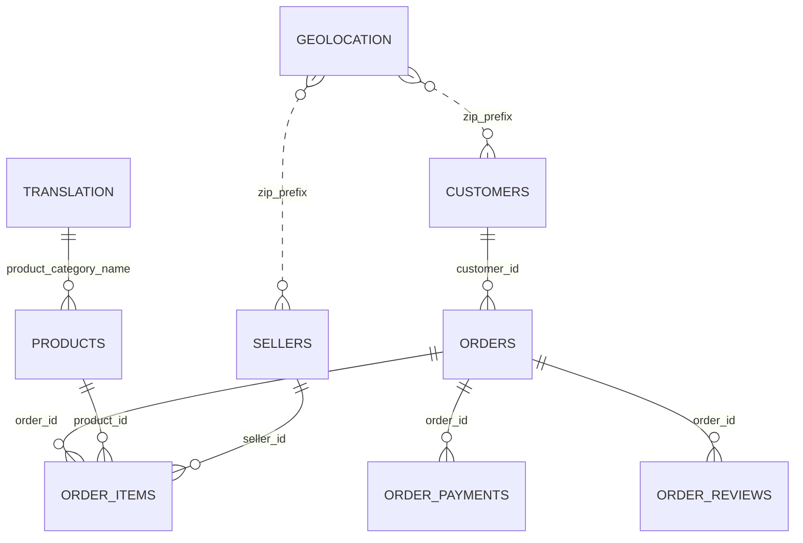

# 阶段 0：数据关系、检查结果与口径

数据来源：[Olist 数据集](https://www.kaggle.com/datasets/olistbr/brazilian-ecommerce)，数据集页面列出的许可为 CC BY-NC-SA 4.0。该数据为历史匿名数据，不代表当前经营状况。原始 CSV 放在 data/raw/，不纳入 Git；逐单的清洗副本也被忽略。

图中品类和邮编关系为查找关系，并非强制数据库约束；实测存在缺失和无法匹配的记录。各表粒度、候选键和外键检查见 `results/tables/00_table_profile.csv`、`00_key_uniqueness.csv`、`00_foreign_keys.csv`。

## 关键口径

- `customer_id` 是订单对应的客户记录，同一客户不同订单可能有不同的 `customer_id`。人数、复购和用户分层使用 `customer_unique_id`。
- 经营指标只统计 `order_status = delivered`，用于观察已交付订单，不能代表全部下单交易额，也无法确保没有退款。按下单日期归属将有已交付订单选择偏差，数据截尾附近的月份尤其应谨慎解读。
- 用户已确认：已送达但送达日期缺失、不可解析或早于下单时间的订单，保留在经营指标中，只从配送分析中剔除。本次数据为 96,478 个已送达订单，其中送达时间缺失 8 个、早于下单时间 0 个，合计 0.008292%；低于 1% 的暂停阈值。
- 经营基础清洗按顺序检查订单 ID 和下单时间，分别排除 0、0 行。配送分析单独按上述时间规则依次排除 8、0 行，剩余 96,470 行；阶段 3 还需检查预计送达时间及评价，不能把该数字当作最终回归样本量。清洗日志：`00_cleaning_log.csv`、`00_delivery_exclusion_log.csv`。

## 实际核查结果

- 全部订单的下单时间范围为 2016-09-04 21:15:19 至 2018-10-17 17:30:18。各状态数量和每张表行数见 `00_order_status.csv`、`00_table_profile.csv`。
- orders、customers、products、sellers 的 ID，以及商品明细与支付明细各自的复合候选键均无缺失或重复。reviews 的 review_id 与 order_id 分别并不唯一，但 `(review_id, order_id)` 组合在本数据中唯一；96,478 个已送达订单中有 525 个对应多条评价，646 个没有评价。评价分析须明确多评价处理方式并报告无评价样本的排除情况。
- 核心订单、客户、商品明细、卖家、支付和评价关联的非空外键匹配率均为 100%。商品品类名称缺失 610 行；非空品类中 13 行找不到英文翻译。已送达订单的商品明细中，有 1,559 行不能匹配到英文品类，应保留明细，不能静默丢弃。用户已确定：葡语品类名存在但缺翻译时保留原名，葡语品类名缺失时标记未知；具体拆分见阶段 1。
- 地理位置表有 261,831 行与其他行完全相同；邮编前缀不是唯一键。客户和卖家邮编分别有 278、7 行找不到匹配地理位置。仅按邮编直接连接地理位置表会造成行数膨胀，需要先选择适当的唯一粒度。州字段可直接使用客户表。
- 评价标题缺失 87,658 行，评价正文缺失 58,274 行，这不代表评分缺失；评分范围检查未发现超出 1–5 或不可解析的记录。商品价格和运费没有缺失或负值；运费为 0 的 383 行保留。价格最小 0.85、中位数 74.99、99% 分位数 890、最大 6,735，单位为巴西雷亚尔；极端高值可能是真实订单，不凭大小直接删除。

原始字段的缺失全量清单见 `00_missingness.csv`，覆盖风险见 `00_analysis_risks.csv`。上述值由 `src/stage0.py` 实际运行生成，清洗不修改原始文件。阶段 0 仅建立数据质量和口径基础，后续仍应独立验证核心指标。
