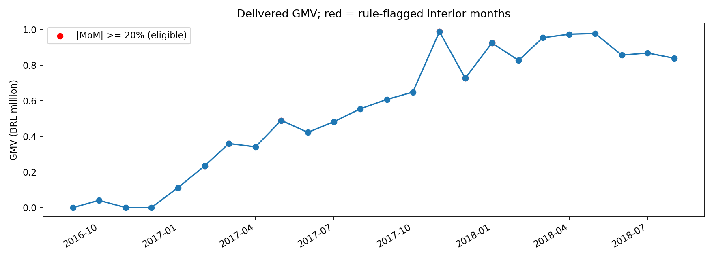
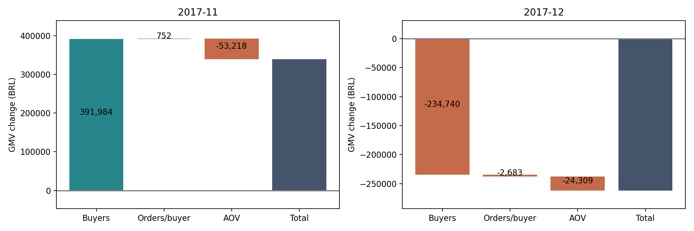

# 阶段4：GMV 异动诊断

## 问题与边界

诊断已送达订单的商品 GMV 为什么变化。经营口径保留缺送达日期的 8 单，按 customer_unique_id 去重买家，州来自 customers；金额不含运费。全量 96,478 单、93,358 位买家、R$13,221,498.11，沿用阶段1。

月度表覆盖观察期，`interior_month` 只表示非首尾月，不保证数据采集完整。排除首尾 2016-09、2018-08：前者从月中开始，后者观察窗口在月末前结束且已送达口径存在右截断。案例选择额外限定 2017-01 至 2018-07，避免 2016 年稀疏启动期（11月无已送达订单）造成小基数比较；该限制是分析选择，不是已证实的采集完整性。首个可分析月没有合格前月，不判断异常。

规则固定为相邻合格月份 |GMV 环比|≥20%，从规则命中月份中按 GMV 增加金额最大、减少金额最大各选一个。阈值是演示诊断规则，不是显著性检验；不根据业务故事反向指定月份。月表保留全部月份及资格标记，便于检查阈值敏感性。未采用同比，因为可比年份短；没有把黑五当作已验证原因。

## 实际案例

| 月份 | GMV (R$) | 环比 | 变化 (R$) |
|---|---:|---:|---:|
| 2017-10 | 648,247.65 | — | — |
| 2017-11 | 987,765.37 | +52.37% | +339,517.72 |
| 2017-12 | 726,033.19 | −26.50% | −261,732.18 |

11月确有峰值，日期与黑五相近，但没有促销曝光、预算、价格实验或外部对照，无法把全部变化归为黑五效果。

## 两层归因

第一层恒等式 `GMV = 买家数 × 人均订单 × AOV`，各因子定义为买家数、订单数/买家数、GMV/订单数。主方法 LMDI：`C_j=L(G1,G0) ln(x1j/x0j)`，其中 `L=(G1−G0)/(ln G1−ln G0)`；总额相同取连续极限。案例因子均为正，不给零值任意加 epsilon；函数遇零报错。LMDI 无残差且不依赖替换顺序，适合面试解释；它仍然只是恒等式分摊。对照按买家、人均订单、AOV 依次连乘替代，交互项归属随顺序改变。

| 案例月 | 买家贡献 | 人均订单贡献 | AOV贡献 | LMDI合计 |
|---|---:|---:|---:|---:|
| 2017-11 | 391,983.58 | 752.48 | −53,218.34 | 339,517.72 |
| 2017-12 | −234,740.22 | −2,683.14 | −24,308.82 | −261,732.18 |

第二层分别按品类、州、新老客计算 `ΔGMV_g` 及 `ΔGMV_g/ΔGMV`。每个维度单独加总为总变化，不把三个维度叠加。新客为本数据已送达首单所在月，首次观察不等于真实首次购物；多品类订单按商品行金额拆到品类。

| 维度 | 11月增加前三名（R$） | 12月减少前三名（R$） |
|---|---|---|
| 品类 | bed_bath_table +41,949.93；health_beauty +37,575.41；furniture_decor +32,081.53 | bed_bath_table −37,876.47；computers_accessories −32,247.65；furniture_decor −31,018.18 |
| 州 | SP +130,986.10；RJ +52,290.16；MG +51,975.98 | SP −75,838.44；MG −41,533.19；RJ −35,522.77 |
| 新老客 | 首单月访客 +335,841.68；后续月 +3,676.04 | 首单月访客 −262,770.48；后续月 +1,038.30 |

贡献占比允许负值或超过100%：12月新客下降被老客小幅上涨抵消。

为区分结构与组内变化，采用统一的商品件数基数，`GMV=Q Σ(s_g r_g)`，Q为全部件数，s为组的件数占比，r为组内平均件单价。依次替换 Q、s、r：规模项 `(Q1−Q0)s0r0`，结构项 `Q1(s1−s0)r0`，组内项 `Q1s1(r1−r0)`。新增/消失组用另一期间的单价延续，不虚构无法观察的组内单价变化。此“组内”包含价格与组内商品组合变化，不能叫纯价格效应。

例如11月按品类分解：规模 +405,434.52、结构 −70,553.56、组内 +4,636.76；12月分别 −266,667.51、+31,491.13、−26,555.79。每组和每维度都可对账。完整输出见 `04_factors.csv`、`04_drilldown.csv`，以未四舍五入数据对账，最大误差约 1.75e−10 元。
