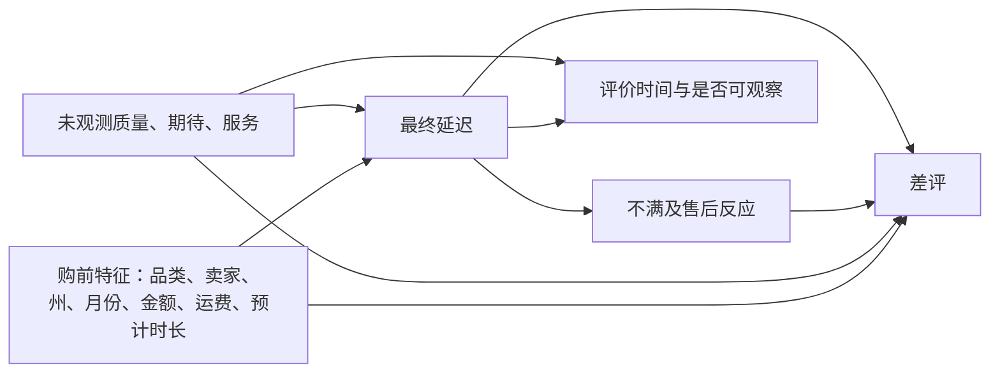
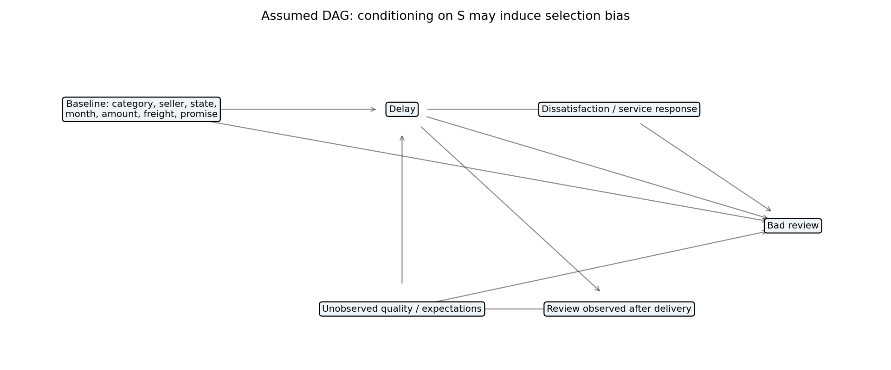
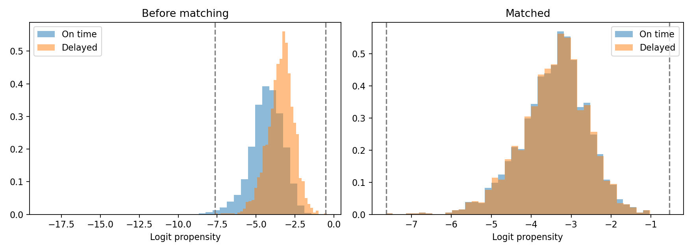
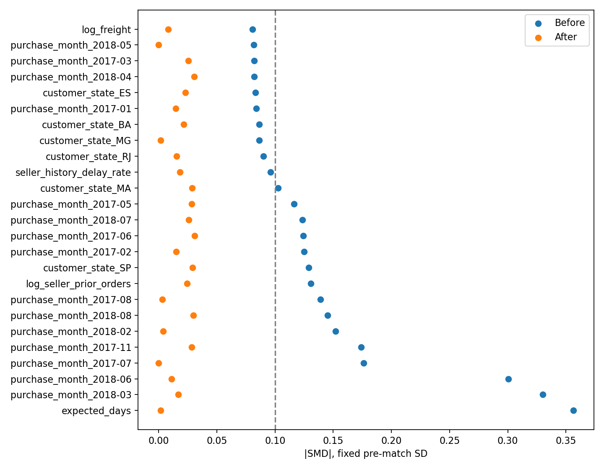

# 阶段5：配送延迟与差评的因果检验

## 设计、DAG与识别边界

这是一项观察性稳健性检验。日期口径延迟为实际送达日超过预计送达日；差评为最新回复评价≤2分。沿用阶段3的订单主品类与最新回复时间规则，只纳入回复时间≥实际送达时间的订单：排除 4,653 单后，分析 91,171 单，其中延迟 1,908 单、准时 89,263 单。避免用收货前评价解释最终物流结果；但剔除本身可能造成选择偏差，并不自动恢复可交换性。

先提出如下因果假设，图并非数据证明：

品类、主卖家、客户州、跨州、下单月份、商品金额、运费、件数、预计配送天数作为可观察的购前代理混杂变量。卖家由最高价格明细确定，同价按明细序号；多卖家订单这一压缩不能替代完整卖家组合。州与跨州仅是距离代理，未加入地理坐标距离。金额与运费假设是下单已确定的金额，若存在售后调整则这一假设会受损。

不控制实际运输时长：它构成延迟的一部分；不控制不满、售后、退款等潜在中介，也没有这些字段。收货后评价筛选条件S可能是延迟和未观测因素的共同结果，对S条件化会引入碰撞偏差。缺少天气、承运商、真实距离、用户预期和商品质量，无法排除未观测混杂。

## 方法与结果

分层：按主品类、客户州分别比较差评率，只纳入同时存在延迟和准时订单的层，再按延迟订单数加权风险差。层内样本量和差评率完整输出到 `05_strata.csv`；缺失另一处理组的层不外推。

PSM新版：移除主卖家one-hot，换成log1p卖家历史订单数、历史已完成配送的延迟率、无订单历史、无已完成配送历史标记。历史订单数使用有商品明细可确定主卖家的全部状态订单，严格要求下单时间早于当前下单；历史延迟率还要求送达时间严格早于当前下单，不能利用尚在配送中的历史订单最终结果。无已完成历史时比率置零，并用单独标记区分。SQL使用时间线累计与严格ASOF，pandas使用searchsorted独立逐单复核。数据仅有最终快照，仍假设下单金额、主卖家等记录代表当时已知信息。

其他连续特征为log1p金额、log1p运费、件数、跨州、预计时长。品类、州中处理组少于20单的水平合并为`[other]`，月份保留one-hot；映射和计数见`05_level_pooling.csv`，合并与拟合均不使用差评结果。没有启用品类精确匹配。L2逻辑回归C=1，卡钳为全样本logit标准差的0.2倍（新版0.214112），共同支撑内按延迟组得分降序、1:1最近邻无放回匹配。

SMD 用处理组与对照组均值差除以匹配前两组方差的平均平方根；匹配后沿用同一分母，分类变量逐个哑变量检查。|SMD|<0.1 为事先采用的平衡诊断阈值，参见 [Austin 2011](https://pmc.ncbi.nlm.nih.gov/articles/PMC3144483/)。它不是因果识别的充分条件。

- 新版匹配1,907对、3,814单，保留1,908单延迟订单中的99.95%；一单因共同支撑/卡钳限制未匹配，不向其或收货前评价样本外推。
- 新版68列协变量最大|SMD|从0.3562降到0.0538，无列≥0.1，**已达到纳入的可观测协变量均值平衡标准**。均值平衡不保证完整分布平衡，也不能排除未观测混杂。
- 新版ATT形式风险差+10.54个百分点，固定匹配对bootstrap 1000次、种子20261101，95%区间[8.39,12.85]个百分点。区间仅反映固定匹配对的条件抽样变化，未包含倾向模型估计、重新匹配与同买家跨订单相关性，属探索性区间。
- 旧版（含卖家one-hot，未平衡）保留：3,043列、1,908对，最大|SMD|从0.3562降至0.2214，43列≥0.1；ATT+7.97个百分点，区间[5.35,10.12]。结果归档为`05_legacy_psm_*`和`05_legacy_method_comparison.csv`，来源提交aad71e5。两次估计变化不代表消除了全部偏差。

平衡图展示匹配前失衡最大的25列，完整诊断必须看 `05_balance.csv`，不能仅凭这张图判断通过。

| 方法 | 估计量 | 实际结果 | 95%区间 |
|---|---|---:|---|
| 全部有评价订单原始比较 | 风险差 | +53.15百分点 | 未计算 |
| 收货后评价原始比较 | 风险差 | +10.19百分点 | 未计算 |
| 品类分层 | 延迟者加权风险差 | +10.03百分点 | 未计算 |
| 州分层 | 延迟者加权风险差 | +10.08百分点 | 未计算 |
| PSM新版：卖家购前汇总，已达均值平衡 | 匹配延迟者风险差 | +10.54百分点 | [8.39,12.85] |
| PSM旧版：含卖家one-hot，未平衡 | 匹配延迟者风险差 | +7.97百分点 | [5.35,10.12] |
| 卖家固定效应线性概率模型 | 卖家内调整风险差 | +9.52百分点 | [7.88,11.16] |
| 阶段3全评价回归 | 调整OR | 16.80 | [15.86,17.80] |
| 阶段3收货后评价回归 | 调整OR | 2.38 | [2.12,2.69] |

OR 是优势比，不是风险差或风险比，不能与百分点相除比较，也不能直接称为“差评概率提高16.8倍”。两项OR使用阶段3原公式重新拟合；其他方法的人群与控制集合不完全相同。OR变化同时反映了时间筛选、人群改变、潜在选择偏差及OR非可折叠性，不能说“消除了混杂所以真效应是2.38”。

卖家固定效应补充检验：采用组内去均值的线性概率模型，控制连续变量、品类、州和购买月份，标准误按主卖家聚类。它吸收卖家不随订单变化的特征，不解决卖家内随时间变化的混杂；线性概率模型也不是条件logit，不能将其系数解释为OR。

## 剂量反应与不做的准实验

| 延迟组 | 订单数 | 差评率 |
|---|---:|---:|
| 准时 | 89,263 | 9.25% |
| 1–3天 | 1,436 | 18.59% |
| 4–7天 | 396 | 20.45% |
| 7天以上 | 76 | 30.26% |

观察率单调上升，但最末组仅76单，且剂量同时与承运、商品、地域和评价筛选相关；梯度支持进一步调查，不能证明剂量因果关系。

不做预计送达日期附近的RDD：预计时间由订单与物流决策内生确定，跨过阈值本身用于定义“延迟”，缺乏一个明确的、在阈值处外生改变服务处理的分配机制，也没有验证不可操纵性、连续性和局部可比性。卖家内比较是稳健性分析，不是自然实验。

综合结论：收货后评价样本中，延迟与差评仍有正相关，不同方法方向一致；新版PSM已达可观测协变量均值平衡，仍不能排除未观测混杂、评价时间选择、卖家自选择和样本外推限制均存在。无法从本案例得出“消除延迟会使差评下降10.54个百分点”的政策结论，需要更可靠的准实验或随机物流干预。
